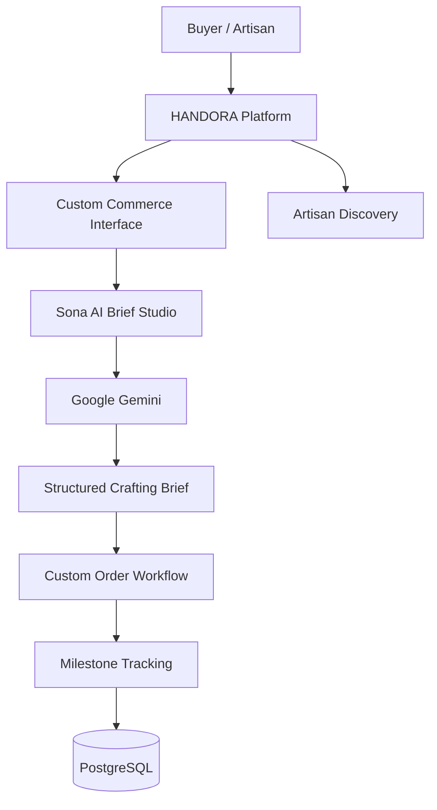
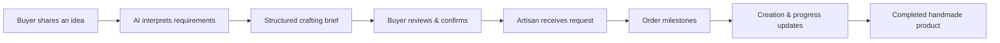

# HANDORA
### Where Every Handmade Creation Finds Its People.

<p align="center">
  <strong>An AI-powered custom commerce platform built for artisans and people who dream beyond ready-made products.</strong>
</p>

<p align="center">
  
  
  
  
</p>

---

## ✦ About HANDORA

HANDORA is an AI-assisted custom handmade marketplace that bridges the gap between a buyer's imagination and an artisan's craftsmanship.

From personalized gifts and handcrafted jewellery to custom decor and bespoke creations, HANDORA transforms vague ideas into structured, actionable crafting briefs and helps customers and makers navigate the custom-order journey with clarity, transparency, and trust.

We believe handmade commerce should be more than exchanging messages. It should be an experience where ideas are understood, expectations are clear, and creativity meets the right people.

---

## 🧩 The Problem

Custom handmade commerce is still largely managed through Instagram DMs, WhatsApp conversations, and informal transactions.

This creates three major challenges:

- **Specification Chaos:** Buyers struggle to explain what they envision, while artisans receive unclear requirements, leading to misunderstandings, revisions, and wasted time.
- **Trust & Payment Risk:** Buyers and makers lack a structured process for agreeing on pricing, deliverables, timelines, and payment expectations.
- **Discovery Gap:** Independent artisans struggle to reach the right customers beyond their existing social media audience.

The result? Great ideas get lost in conversations, creativity becomes difficult to manage, and both sides face uncertainty.

---

## 💡 Our Solution

HANDORA brings custom handmade commerce into one structured, intelligent platform.

Instead of scattered messages and unclear expectations, buyers can describe what they want, AI helps organize their ideas into detailed briefs, and artisans can manage custom requests through a transparent workflow.

### What makes HANDORA different?

| Traditional Custom Commerce | HANDORA |
|---|---|
| Endless DM conversations | Structured AI-generated briefs |
| Unclear requirements | Organized specifications |
| Difficult order coordination | Transparent milestone workflow |
| Limited artisan discovery | Dedicated handmade marketplace |
| Uncertain progress | Clear order status tracking |

---

## ✨ Core Features

### 🪄 Sona AI — Multimodal Brief Studio
An AI-powered creative assistant designed to understand a buyer's imagination and transform it into a structured custom crafting brief.

- Natural-language idea input
- Image inspiration and reference support
- Product specification extraction
- Customization details and preferences
- Structured crafting briefs for artisans
- AI-powered refinement of ideas

Powered by Google Gemini.

### 🔗 Shareable Custom Order Links
Make custom commerce easier to initiate and share.

- Share custom requests across social platforms
- Reduce friction between social discovery and order creation
- Bring buyers and artisans into a structured workflow

### 📦 Transparent Milestone Tracking
A clearer way for buyers and artisans to manage custom orders.

- Order milestones
- Progress updates
- Customization confirmation
- Timeline visibility
- Order status tracking

### 🧵 Artisan Discovery
Help buyers discover independent makers and handmade creations.

- Artisan profiles
- Craft categories
- Customization capabilities
- Portfolio-based discovery

---

## 🛠️ Technology Stack

| Layer | Technology |
|---|---|
| AI & Intelligence | Google Gemini API |
| Backend Framework | FastAPI |
| Data Validation | Pydantic |
| Database | PostgreSQL |
| Vector Search | pgvector |
| Frontend | Frontend stack under development |
| API Architecture | REST APIs |
| Version Control | Git & GitHub |

---

## 🏗️ Architecture



---

## 🔄 How HANDORA Works



1. **Imagine** — A buyer describes a handmade product they want.
2. **Transform** — Sona AI converts the idea into a structured brief.
3. **Refine** — Buyer reviews specifications, references, and customization.
4. **Connect** — The request reaches the appropriate artisan.
5. **Create** — Artisan works through agreed milestones.
6. **Complete** — Buyer and maker follow the order journey to completion.

---

## 🎯 Target Audience

### Buyers
People looking for personalized, meaningful, customized, and handmade products instead of mass-produced alternatives.

### Artisans & Independent Makers
Creators, craft entrepreneurs, home-based makers, and small handmade businesses seeking better tools to manage and grow their custom-order operations.

---

## 🌍 Market Focus

**Primary Market:** India

Initial focus on artisan and customer communities in:

- Punjab
- Delhi NCR
- Andhra Pradesh
- Telangana

**Expansion Opportunities:** United States, United Kingdom, and UAE.

---

## 💰 Business Model

HANDORA follows a transaction-led marketplace model.

- **Marketplace Commission:** Proposed 8–12% commission on completed custom orders.
- **HANDORA Pro:** Planned subscription offering for artisans, with advanced tools and enhanced visibility.
- **Future Opportunities:** Premium AI tools, business analytics, promotional features, and artisan growth services.

*Pricing and monetization are subject to validation and iteration.*

---

## 🔐 Trust & Transparency

HANDORA aims to create a more reliable custom-commerce experience through:

- Clearly defined custom-order specifications
- Buyer and artisan confirmation workflows
- Milestone-based progress visibility
- Transparent timelines and pricing expectations
- Reduced ambiguity in custom product transactions

---

## 🗺️ Roadmap

- [x] Startup concept and problem validation research
- [x] Product vision and core workflow definition
- [x] MVP planning
- [ ] Marketplace UI development
- [ ] Artisan onboarding and profiles
- [ ] Sona AI Brief Studio integration
- [ ] Custom-order workflow
- [ ] Milestone tracking
- [ ] Database and API integration
- [ ] Testing and customer validation
- [ ] MVP deployment
- [ ] Pilot with real artisans and buyers

---

## 🤝 Contributing

HANDORA is being built collaboratively.

We welcome contributions, ideas, feedback, bug reports, and discussions that help improve the custom handmade commerce experience.

### Development Workflow

1. Fork or clone the repository.
2. Create a feature branch.
3. Make your changes.
4. Commit with a descriptive message.
5. Submit a Pull Request for review.

```bash
git clone https://github.com/Krishnapriya1911/handora.git

cd handora

git checkout -b feature/your-feature-name
```

---

## 👥 ## 👥 Team Kalakriti — Founders

HANDORA is built by **Team Kalakriti**, a team driven by the vision of making handmade commerce more accessible, organized, and trustworthy through technology.

### Co-Founders

**Kella Krishna Priya — Co-Founder | Cloud & DevOps**

Leading cloud infrastructure, DevOps engineering, deployment, automation, CI/CD pipelines, infrastructure management, and platform reliability.

**Anchal Jaiswal — Co-Founder | Full-Stack Development**

Leading full-stack development, frontend and backend engineering, application architecture, API integration, and product development.

**Team Kalakriti**

Building HANDORA from an idea into a scalable, AI-powered handmade commerce platform.

---

## 📌 Our Vision

We want to build a world where every artisan has the tools to turn their creativity into a livelihood—and every buyer has the confidence to turn their imagination into something real.

Handmade shouldn't be hard to find. Custom shouldn't be hard to order. Creativity shouldn't get lost in chat.

**HANDORA — Where Every Handmade Creation Finds Its People.**

---

<p align="center">
  Made with creativity, technology, and a love for handmade.
</p>
